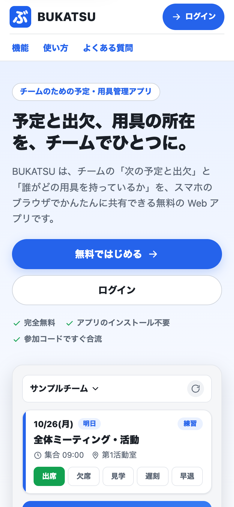
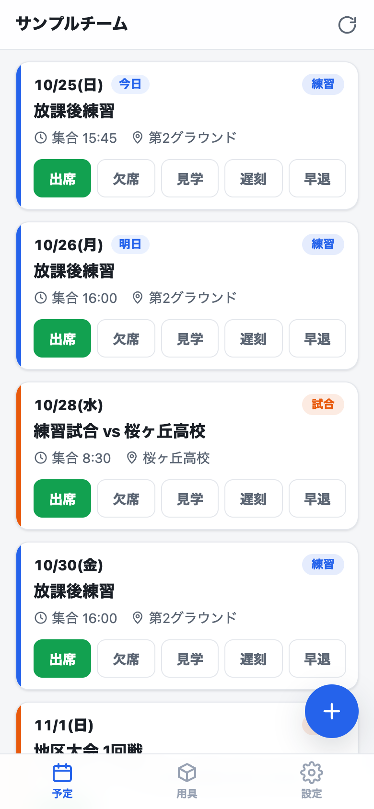
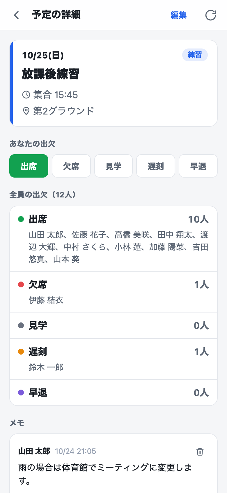
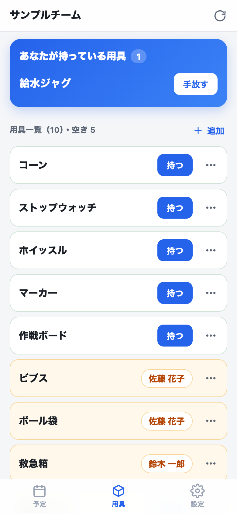

# BUKATSU

**「次の活動に誰が来るか」と「必要な用具を誰が持っているか」を、ひとつのアプリで。**

BUKATSUは、部活・サークルなどのチーム向けに、予定・出欠と共有用具の所在を管理するWebアプリです。JPHACKS 2026の作品として開発しています。

| 紹介ページ | 予定一覧 | 予定の詳細 | 用具 |
| :---: | :---: | :---: | :---: |
|  |  |  |  |

※ 画像はモックのサンプルデータで表示したものです。

## デモ動画

[YouTubeでデモ動画を見る](https://youtu.be/jk7Fby7LXbA)

## BUKATSU

[BUKATSUを使う（Firebase Hosting）](https://bukatsu20261024.web.app/)

インストールせず、スマホ・PCのブラウザから利用できます。初めて開いた人には、アプリを紹介するページを表示します。チームのリンクから来た人や、その端末で一度ログインしたことがある人には、ログイン画面から表示します。メールアドレスとパスワード、またはGoogleアカウントで登録・ログインし、管理者から共有された参加コードでチームに参加します。新しいチームを作ることもできます。

メールとパスワードで登録した場合は、確認メールのリンクを開いてからチームの作成・参加へ進みます。
## 製品概要

### 背景（製品開発のきっかけ、課題等）

チームの活動準備には、予定と出欠の確認に加えて、共有用具の持ち主の確認も必要です。出欠表とチャットなどに情報が分かれていると、活動前にメッセージをさかのぼって用具を探したり、遅刻・見学などの連絡を一人ずつ確認したりする手間が生じます。

BUKATSUは、こうした日常的な確認をまとめ、メンバーも管理者も活動の準備を進めやすくすることを目指しています。デモの想定規模は1チーム50人です。

### 製品説明（具体的な製品の説明）

メイン画面は「予定」「用具」「設定」の3つのタブで構成します。

| タブ | できること |
| --- | --- |
| 予定 | 今日以降の予定の確認、出欠の回答、全員の出欠状況の確認、予定ごとのメモの投稿。権限に応じた予定の作成・編集・削除と、毎週の予定の一括追加 |
| 用具 | 用具の現在の持ち主と空き状況の確認、自分が持つ・手放す操作、用具の追加・編集・削除 |
| 設定 | チーム内の表示名の変更、チームの追加、参加コードやアプリのリンクのコピー、管理者によるメンバー・権限・チームの管理 |

1つのアカウントで複数のチームに所属でき、チームごとに別の表示名を使えます。2チーム以上に所属すると、ヘッダーのチーム名の位置から切り替えられます。

ログインしていないときは、機能・使い方・よくある質問をまとめた紹介ページを表示し、そこから新規登録・ログインへ進めます。

### 特長

#### 1. 「誰が来るか」と「誰が用具を持っているか」を一か所で確認

予定・出欠と用具の所在を同じアプリにまとめています。予定タブで参加状況を確認し、用具タブへ切り替えると、共有用具を誰が持っているか確認できます。

自分が持っている用具は一覧の上部にまとめて表示し、誰も持っていない用具は空きとして見分けられます。「持つ」「手放す」の操作で状態を共有でき、活動の準備に必要な情報を探す手間を減らします。

#### 2. 部活の日常に合った、具体的な出欠回答

「出席・欠席・見学・遅刻・早退」の5種類から、予定一覧のボタンで回答できます。「遅れて参加する」「活動には参加せず見学する」といった状況を、毎回文章で説明する手間を減らします。補足が必要なときは、予定のメモ欄に書き込めます。

**未回答は出席として扱い、未回答と出席を区別しません。** 出席を基本として、変更がある人だけが知らせるチームの運用を想定しています。

#### 3. 必要な操作に絞った画面構成

日々の操作は「予定・用具・設定」の3タブから行えます。予定は今日以降のものを近い順に表示し、詳細画面を開かなくても出欠を変更できます。用具は空いているものを上にまとめ、持ち主は一覧で確認できます。

スマホの縦画面を基準に、片手で操作しやすいボタンの大きさや余白を設計しています。ブラウザの更新操作に頼らず情報を取り直せるよう、画面内に再取得ボタンも配置しています。

### 解決出来ること

- 出欠表と用具の連絡を別々に探す手間を減らす。
- 見学・遅刻・早退の連絡を、全員が確認できる形で整理する。
- 自分が預かっている用具と、現在空いている用具を把握する。
- 毎週の活動予定を、曜日と期間を指定してまとめて登録する。
- 複数チームへの所属とチームごとの表示名を、1つのアカウントで管理する。

### 今後の展望

- 公開Googleカレンダーからの予定取り込みを検討する（現在は未実装）。
- 想定する50人規模で読み取り回数や更新の反映を確認し、無料枠の範囲で継続運用できるか検証する。

### 注力したこと（こだわり等）

- **スマホでの使いやすさ**：縦横の画面、セーフエリア、日付・時刻入力を考慮し、PCでは画面幅に合わせてレイアウトを切り替えます。
- **用具の状態の整合性**：同じ用具を2人が同時に確保することを防ぎます。管理者による強制的な所持解除では、確認後に持ち主が変わっていないかも検証します。
- **権限の強制**：画面上の制御に加えて、Firestoreセキュリティルールで所属・編集権限・本人の出欠更新を検証します。最後の管理者を失う操作も防ぎます。
- **無料枠を前提にした設計**：Firebase Sparkプランの範囲で構成し、Cloud Functionsは使いません。必要なデータだけを購読し、画面が非表示の間は購読を停止します。利用量によって無料枠を超える可能性があるため、無制限の利用を保証するものではありません。

## 開発技術

### 活用した技術

#### API・データ

- **Firebase Authentication**：メール／パスワード・Google認証、確認メール、パスワード再設定。
- **Cloud Firestore**：チーム・予定・出欠・メモ・用具の保存、リアルタイム購読、セキュリティルールによる権限検証。
- **Firebase Hosting**：Webアプリの配信。

#### フレームワーク・ライブラリ・モジュール

- **React・TypeScript・Vite**：WebアプリのUIとビルド。
- **CSS Modules・CSSカスタムプロパティ**：画面ごとのスタイルと共通デザイントークン。
- **Vitest・React Testing Library・Firebase Emulator Suite**：UI、リポジトリ、セキュリティルールの検証。
- **oxlint**：静的解析。

#### デバイス

- スマートフォンのブラウザを主な利用環境として想定しています。
- PC・タブレット向けのレイアウトにも対応しています。
- 専用のハードウェアは不要です。iPhoneのSafari・LINE内ブラウザ・ホーム画面からの起動で、実機での動作を確認済みです（[Firebase接続・公開ガイド](docs/firebase.md)）。

### 独自技術

#### ハッカソンで開発した独自機能・技術

本プロジェクトで実装した、運用を支える仕組みです。

- **予定一覧からの5種類の出欠回答**：[出欠ボタン](src/features/schedule/AttendanceButtons.tsx)と[出欠の定義](src/lib/attendance.ts)。未回答を出席扱いにし、変更時に自分の状態だけを保存します。
- **所持者と所持数をそろえた用具管理**：[Firestoreリポジトリ](src/data/firebase/firestoreRepository.ts)と[セキュリティルール](firestore.rules)。用具の所持変更とメンバーの所持数を同じトランザクションで更新し、競合や不正な更新を検証します。
- **毎週の予定の一括追加**：[予定フォーム](src/features/schedule/EventForm.tsx)と[日付生成処理](src/lib/weekly.ts)。複数の曜日と期間から登録対象の日付を生成し、確認してから最大52件をまとめて作成します。
- **画面復帰時の購読管理**：[RefreshProvider](src/app/RefreshProvider.tsx)と[useSubscription](src/app/useSubscription.ts)。非表示中の購読を解除し、復帰・再取得時に張り直します。
- **来た人に合わせた最初の画面**：[最初の画面の判定](src/lib/entry.ts)。新規の人には紹介ページ、チームのリンクから来た人・一度ログインしたことがある人にはログイン画面を表示します。共有リンクのパラメーターは読み取り後にアドレスバーから消し、URLをコピーして共有しても広がらないようにしています。
- **複数タブでのログイン状態の保持**：[Firebaseの初期化](src/data/firebase/app.ts)。すべてのログイン方法で保存先をそろえ、同じブラウザで2つ目のタブを開いても1つ目がログアウトしないようにしています。

## LINE・ホーム画面からの利用

チームのメンバーに共有するときは、設定タブの「アプリのリンク」をコピーして送ります。このリンク（`?invite=1&openExternalBrowser=1`）は、LINEから開いても外部ブラウザで開き、紹介ページではなくログイン画面から始まります。端末の設定などでアプリ内ブラウザに開いた場合は、メニューからSafariなどの外部ブラウザで開いてください。Googleログインが使えないアプリ内ブラウザでは、画面に外部ブラウザへの案内を表示します。

Safari・LINE内ブラウザ・ホーム画面のWebアプリでは保存領域が異なり、ログインし直しが必要になることがあります。普段使うブラウザをそろえて利用してください。
